# Deck Builder

Create 3D-model presentations and export each one as a single standalone `.html` file.

## Use it

1. Double-click `Main.html`. It opens with a demo deck that uses one step of every slide type.
2. Click **Deck settings & model**, then **Load STL / GLB…**. Use one STL per part to get named parts straight away. For a GLB, map its nodes to parts.
3. Add steps with **+ Add step**. In the preview, orbit to the angle you want, then click **Use this view** (or press `V`).
4. **Export HTML** (`Ctrl+S`) writes one file that contains the engine, the model, the images and the fonts. Anyone can double-click it, offline.
5. To edit an exported deck later, click **Open…** and pick that `.html` file. Old `config/presentation.js` files from a folder pack can be imported too.

Unsaved work is kept in the browser (IndexedDB) and restored the next time you open Main.html in the same browser.

## Colours

Two palettes that never touch each other.

The **editor** is fixed greyscale with a light/dark button in the top bar. It is
not themeable on purpose — the only colours on screen should be the deck's.

The **presentation** is yours. In **Deck settings → Palette** every colour is a
role: you give it one base hex and theme-maker expands it into a ramp the slides
address by position, never by hex. Add as many as you like — each one publishes
`--color-<name>-01` … `-NN`, so you can reach it straight from a slide's HTML
field, `<b style="color:var(--color-warning-04)">`, and any step can borrow a
different role for its accent from **Layout → Accent colour**.

Positions do the same job in every role:

| | |
|---|---|
| `-04` | trim that reads against the page: kickers, rules, table headings |
| `-05` | a slab: section backgrounds, code blocks |
| `-01` | what sits on that slab |
| `-02` | the hex you picked |

**Surfaces** is the one role with 11 shades (the page, panels, text, dividers)
and it always flips when you switch the presentation to dark. Every other role
has 5 shades and its own **flip** switch: on, the ramp reads backwards on a dark
deck so `-04` stays readable trim and `-05` stays a slab; off, the colour means
the same hue in both themes — which is what you want for a warning or a
pass/fail. **Accents** picks which role paints the deck's accents.

## Slide types

| | | | |
|:--:|:--:|:--:|:--:|
|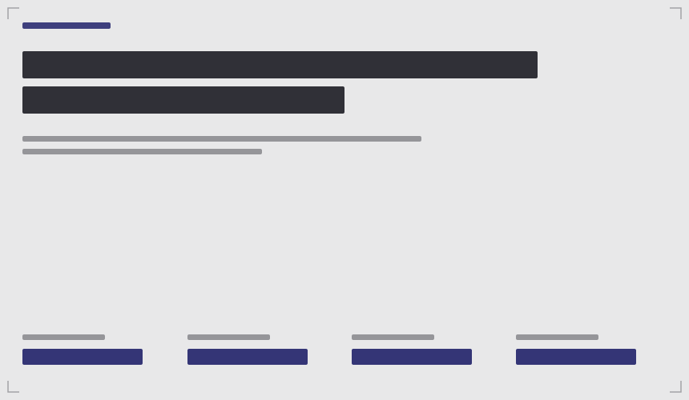 **Title** | 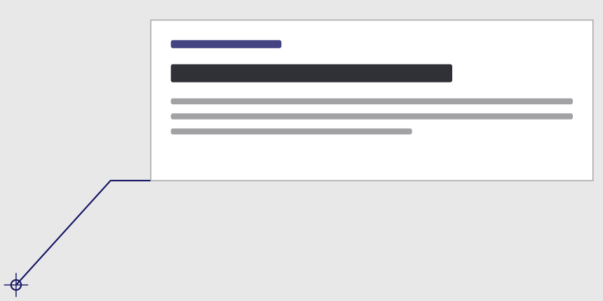 **Callout** | 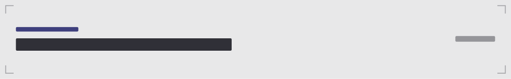 **Caption** | 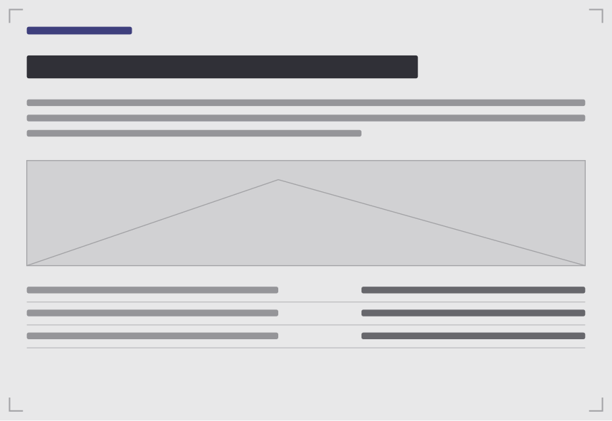 **Card**  |
|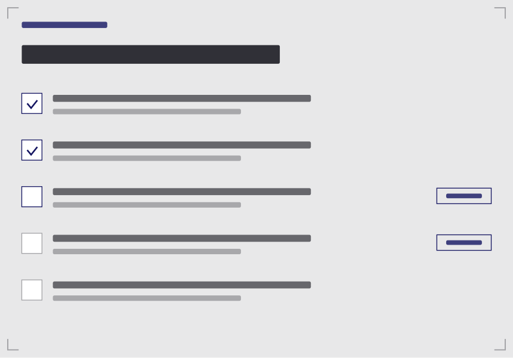 **Checklist** | 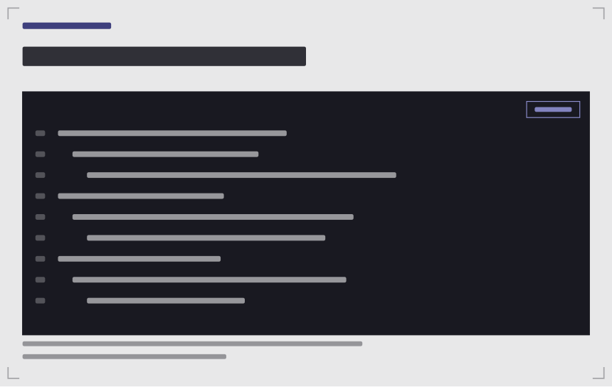 **Code** | 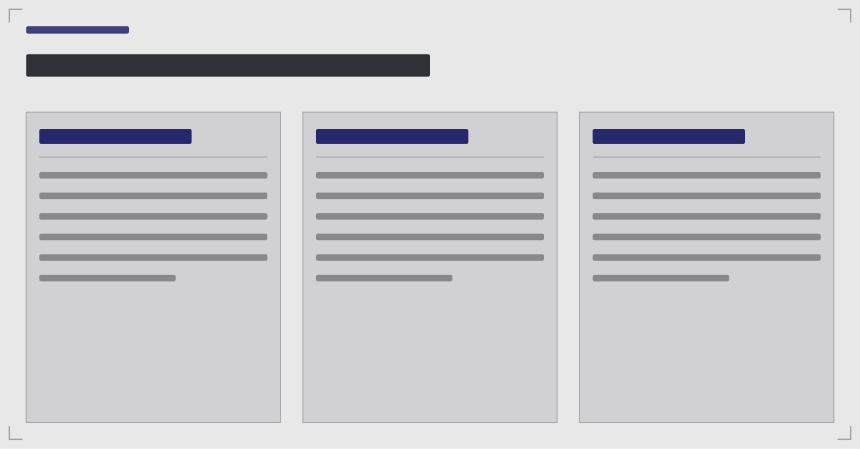 **Compare** | 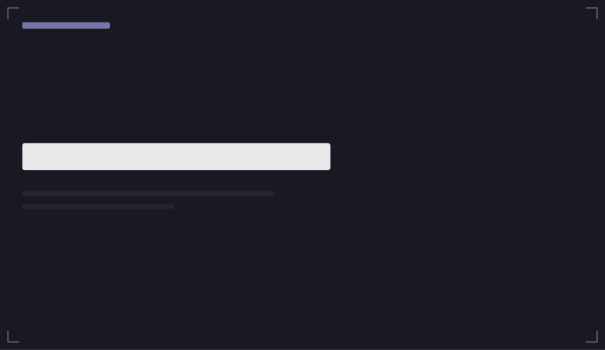 **End**  |
|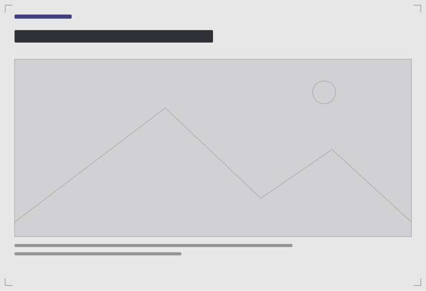 **Image** | 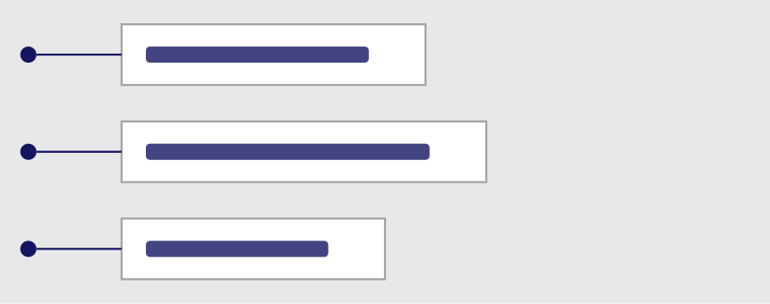 **Labels** | 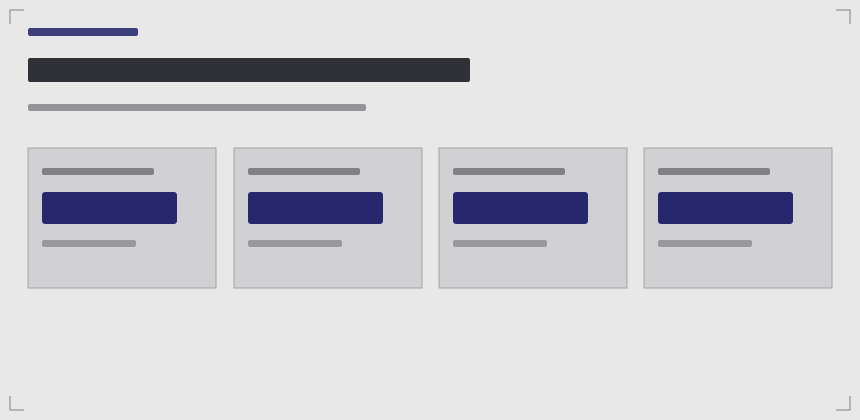 **Metrics** | 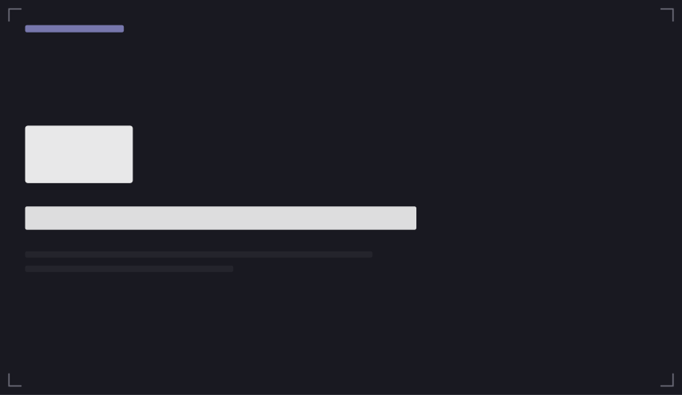 **Section** |
|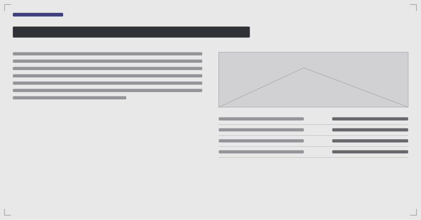 **Split** | 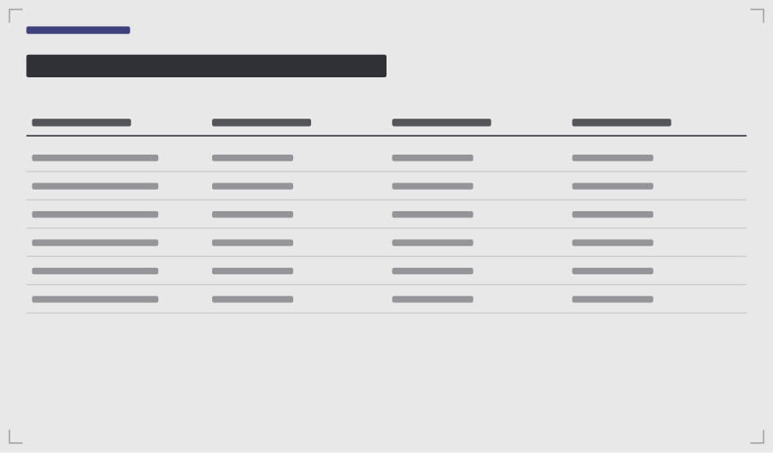 **Table** | 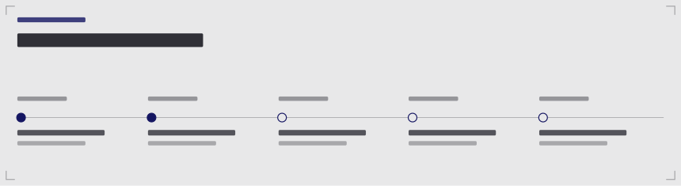 **Timeline** |

Every step can also set focus, highlight, hidden parts, per-part colours, an exploded view, a section cut (X/Y/Z), a camera view and speaker notes. Press `N` in the exported file to show the notes.

Only the current step's slide is shown; **Deck settings → Ghost other slides** brings back the faint floating ones. **Layout → Depth** puts a slide behind the model instead of in front of it. **Model only** (`M`) hides the slides altogether, and stays on as you step through.

Orbit, pan and zoom work over the whole view, the slide included — nothing on screen swallows the pointer except the HUD. Orbit away from a step's own view and its slide fades out of the way on its own; **Deck settings → Fade slides when orbiting** sets how far you may swing first (35° by default, or never). In overview, slides take clicks again, because there clicking one means "go to that step".

## Build from source

Editing a file in `src/` means rebuilding:

    python3 build.py            # writes dist/Main.html
    python3 build.py --test     # also writes dist/test-demo.html (runtime only)

- `src/engine.js`: the 3D slide engine, shared by the editor preview and the exported files. Slide types live in `TYPES` + `RENDER`. The theme block at the top is a port of theme-maker's ramp generator; `node test-theme.js` checks it still matches the library.
- `src/deck.css` and `vendor/industry.css` address colours as `--color-<role>-NN` only. Those variables are written at runtime by `applyTheme` — onto `<html>` in an exported deck, onto `#stage` in the editor, which is what keeps the editor's own greyscale (`src/editor.css`) out of the slides.
- `src/deck.css`: slide and player styles. Theme tokens come from `vendor/industry.css`.
- `src/player.js`, `src/player.html`: the exported file's HUD.
- `src/editor.js`, `src/editor.css`, `src/main.html`: the editor.
- `src/samples.js`: the demo deck and the defaults for new steps.

To add a slide type: add an entry to `TYPES` and a function to `RENDER` in engine.js, defaults in samples.js, a `case` in `renderStepInspector` in editor.js, and its CSS in deck.css.

`source/ARCHITECTURE.md` is a rundown of how the whole thing fits together.

Licences: three.js (MIT, `vendor/three-LICENSE.txt`), Draco decoder (Apache-2.0), Barlow fonts (OFL).
